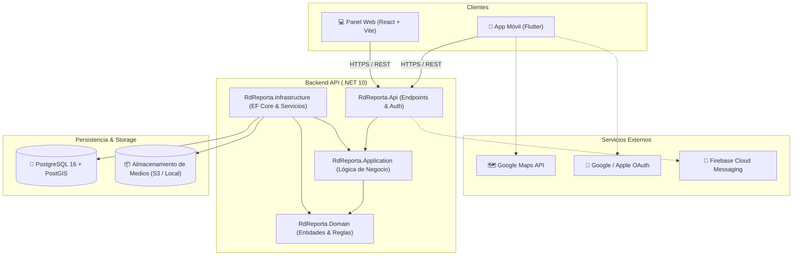

<div align="center">

  

  # RDReporta 🇩🇴

  **Plataforma cívica integral de monitoreo, gestión y reporte geolocalizado de incidencias comunitarias en la República Dominicana.**

  <p>
    <a href="#-características-principales">Características</a> •
    <a href="#-capturas-de-pantalla">Capturas</a> •
    <a href="#-arquitectura-del-sistema">Arquitectura</a> •
    <a href="#-stack-tecnológico">Stack Tecnológico</a> •
    <a href="#-estructura-del-proyecto">Estructura</a> •
    <a href="#-instalación-y-puesta-en-marcha">Instalación</a> •
    <a href="#-seguridad">Seguridad</a>
  </p>

  <p>
    
    
    
    
    
    
    
  </p>

</div>

---

## 📌 Descripción General

**RDReporta** es una solución de tecnología cívica (*CivicTech*) concebida para cerrar la brecha entre los ciudadanos y la gestión de problemas en sus comunidades. Permite a los usuarios documentar, geolocalizar y seguir el ciclo de vida de incidencias cotidianas (como baches viales, averías eléctricas, acumulación de desechos o fugas de agua) en toda la República Dominicana.

La plataforma cuenta con un ecosistema completo compuesto por:
1. **Aplicación Móvil (Flutter):** Experiencia fluida para ciudadanos con mapas interactivos, soporte multimedia, confirmación comunitaria y temas adaptativos.
2. **Backend API (.NET 10 / C#):** Núcleo modular de alto rendimiento basado en *Clean Architecture*, consultas geoespaciales con PostGIS y autenticación JWT.
3. **Panel Web de Administración (React 19 + TypeScript):** Herramienta centralizada para moderación de contenido, auditoría y resolución de incidencias.
4. **Infraestructura Contenedorizada (Docker & PostGIS):** Despliegue estandarizado y reproducible del motor de base de datos espacial y servicios auxiliares.

---

## 📱 Capturas de Pantalla

### Aplicación Móvil

| Feed de Incidencias | Detalle del Reporte | Mapa Geoespacial |
| :---: | :---: | :---: |
|  |  |  |

### Panel Administrativo y de Moderación

<div align="center">
  
</div>

---

## ✨ Características Principales

- 📍 **Geolocalización Precisa con PostGIS:** Consultas de proximidad espacial (`ST_DWithin`, índices `GIST`) para descubrir incidencias alrededor de la ubicación del usuario o en sectores específicos.
- 🗺️ **Mapa Interactivo:** Integración con Google Maps para visualización dinámica de marcadores, clusters y filtrado por cercanía y categorías.
- 📸 **Soporte Multimedia Robusto:** Carga de fotografías y videos con optimización de compresión local en el cliente y validación en el servidor.
- 🤝 **Validación y Reacciones Comunitarias:** Sistema de validación ciudadana ("Yo también lo vi"), contadores de apoyo y métricas de impacto para priorizar problemas críticos.
- 🔄 **Ciclo de Vida de Incidencias:** Estados transparentes de cada reporte (*Pendiente*, *En Revisión*, *Resuelto*, *Rechazado*).
- 🔐 **Autenticación Multi-Proveedor:** Registro e inicio de sesión local seguro (JWT), junto con soporte de autenticación OAuth para **Google Sign-In** y **Apple Sign-In**.
- 🛡️ **Panel de Moderación en Tiempo Real:** Gestión de denuncias por abuso, bloqueo de contenido ofensivo y auditoría de cambios.
- 🌓 **Temas Dinámicos:** Soporte nativo para modo claro y modo oscuro (*Dark Mode*) con diseño ergonómico y accesible.
- 🔔 **Alertas y Notificaciones:** Preparado para notificaciones push en tiempo real mediante Firebase Cloud Messaging (FCM).

---

## 🏗️ Arquitectura del Sistema

El ecosistema aplica principios de **Clean Architecture** y monolito modular, asegurando bajo acoplamiento y alta mantenibilidad.



---

## 💻 Stack Tecnológico

| Componente | Tecnologías |
| :--- | :--- |
| **Mobile** | Flutter 3.x, Dart, Google Maps SDK, Dio, Flutter Secure Storage, Cached Network Image, Video Player |
| **Backend API** | ASP.NET Core (.NET 10), C#, Clean Architecture, Entity Framework Core, Scalar OpenAPI, JWT Bearer |
| **Panel Admin** | React 19, TypeScript, Vite, Tailwind CSS, Lucide Icons, Oxlint |
| **Base de Datos** | PostgreSQL 16, Extensión PostGIS 3.4, NetTopologySuite |
| **DevOps & Entorno** | Docker, Docker Compose, Git |

---

## 📂 Estructura del Proyecto

```text
RdReporta/
├── mobile/                   # Aplicación móvil construida en Flutter
│   ├── lib/                  # Código fuente (Core, Features, Shared)
│   ├── assets/               # Recursos visuales, logotipos e iconos
│   └── pubspec.yaml          # Dependencias y configuración de Flutter
│
├── backend/                  # API Rest desarrollada en ASP.NET Core
│   └── src/
│       ├── RdReporta.Api/            # Controladores, middleware y configuración OpenAPI
│       ├── RdReporta.Application/    # Casos de uso, DTOs e interfaces de servicios
│       ├── RdReporta.Domain/         # Entidades del dominio y reglas de negocio
│       └── RdReporta.Infrastructure/ # Implementación de EF Core, PostGIS y servicios
│
├── admin/                    # Panel administrativo web
│   ├── src/                  # Componentes de React, vistas y lógica de moderación
│   └── package.json          # Dependencias de npm y scripts de Vite
│
├── database/                 # Scripts SQL de inicialización y esquemas de PostGIS
│   └── scripts/              # Migraciones y scripts de arranque
│
├── docker/                   # Orquestación de infraestructura local
│   ├── docker-compose.yml    # Servicios de PostgreSQL/PostGIS y API
│   └── .env.example          # Plantilla de variables de entorno para Docker
│
└── docs/                     # Documentación técnica adicional y especificaciones
    ├── api/                  # Especificación de endpoints
    ├── architecture/         # Documentos de arquitectura detallada
    └── screenshots/          # Capturas de pantalla oficiales
```

---

## 🚀 Instalación y Puesta en Marcha

### Prerrequisitos

Asegúrate de contar con las siguientes herramientas instaladas en tu sistema:
- [Git](https://git-scm.com/)
- [Docker](https://www.docker.com/) y Docker Compose
- [.NET 10 SDK](https://dotnet.microsoft.com/download)
- [Node.js 20+](https://nodejs.org/) y npm
- [Flutter SDK](https://docs.flutter.dev/get-started/install) (para desarrollo móvil)

### 1. Clonar el Repositorio

```bash
git clone https://github.com/EdsenNow/RdReporta.git
cd RdReporta
```

### 2. Levantar la Base de Datos con Docker

Copia la plantilla de entorno e inicia el contenedor de PostgreSQL con PostGIS:

```bash
cd docker
cp .env.example .env
docker compose up -d db
cd ..
```

> **Nota:** Verifica que el contenedor esté en estado saludable ejecutando `docker compose ps` dentro del directorio `docker`.

### 3. Ejecutar el Backend (.NET 10)

```bash
cd backend/src/RdReporta.Api
dotnet restore
dotnet run
```

La API quedará disponible por defecto en `http://localhost:5000`. La documentación interactiva (Scalar / OpenAPI) se encuentra accesible en:
```text
http://localhost:5000/scalar/v1
```

### 4. Ejecutar el Panel Web de Administración

```bash
cd admin
cp .env.example .env
npm install
npm run dev
```

El panel estará disponible en `http://localhost:5173`.

### 5. Ejecutar la Aplicación Móvil (Flutter)

```bash
cd mobile
flutter pub get
flutter run
```

> **Consejo para Emuladores/Dispositivos:** Puedes especificar la URL base del backend mediante `--dart-define`:
> ```bash
> flutter run --dart-define=API_BASE_URL=http://10.0.2.2:5000/api  # En emulador Android
> ```

---

## 🔒 Seguridad y Buenas Prácticas

- **Gestión de Secretos:** Nunca confirmes (`git commit`) archivos `.env`, contraseñas de bases de datos, llaves privadas ni claves de servicios en el repositorio.
- **Plantillas Seguras:** Usa los archivos `.env.example` únicamente como referencia de configuración.
- **Tokens y Credenciales:** Configura secretos mediante variables de entorno del sistema o el gestor de secretos de tu plataforma de producción.
- **Respuesta ante Incidentes:** Si alguna credencial o token llega a exponerse públicamente, revócala y rótala de inmediato; simplemente eliminar el commit no invalida la clave expuesta.

---

## 🤝 Contribuciones

Las contribuciones son bienvenidas para fortalecer las herramientas cívicas de la comunidad. Para contribuir:

1. Crea un *Fork* del repositorio.
2. Crea una rama para tu funcionalidad o corrección (`git checkout -b feature/nueva-funcionalidad`).
3. Realiza tus cambios y escribe mensajes de commit claros siguiendo [Conventional Commits](https://www.conventionalcommits.org/es/v1.0.0/).
4. Sube tu rama (`git push origin feature/nueva-funcionalidad`).
5. Abre un **Pull Request** detallando el propósito y alcance de tus modificaciones.

---

<div align="center">
  <sub>Construido con dedicación para fortalecer la participación ciudadana en la República Dominicana 🇩🇴</sub>
</div>
