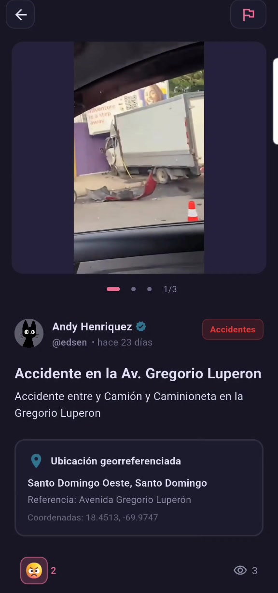
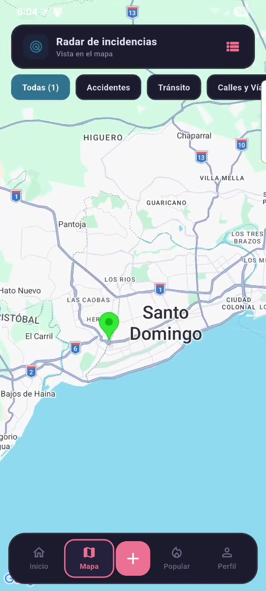
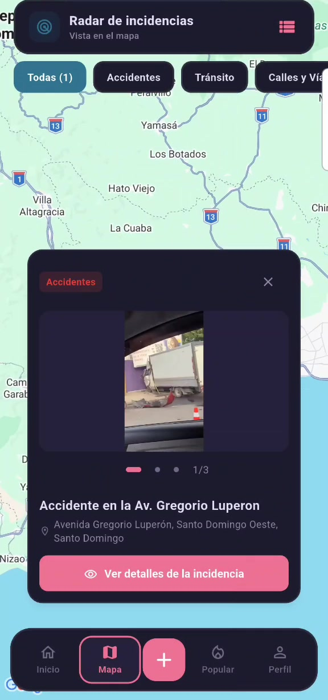
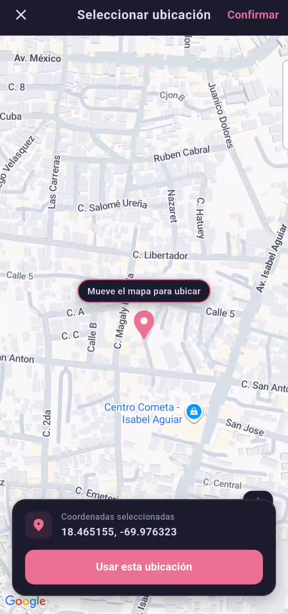
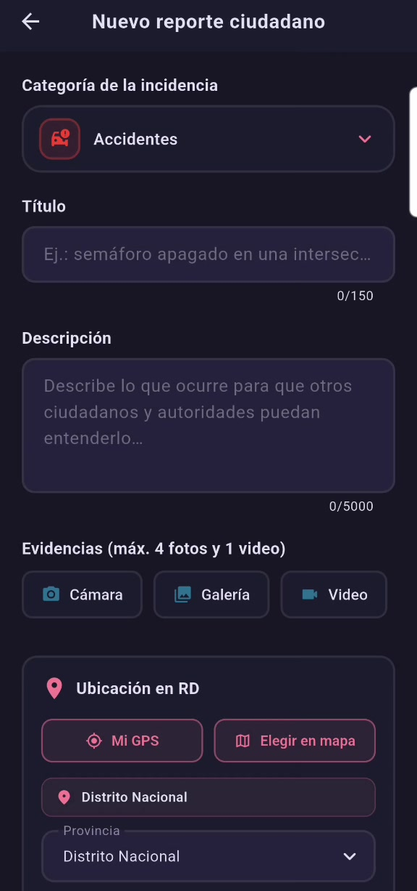
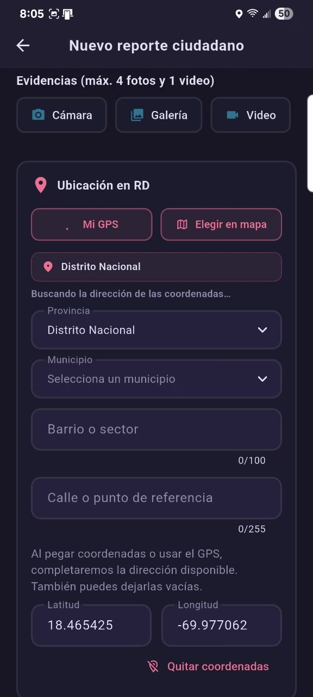
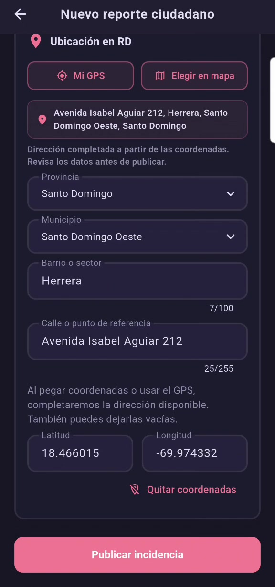
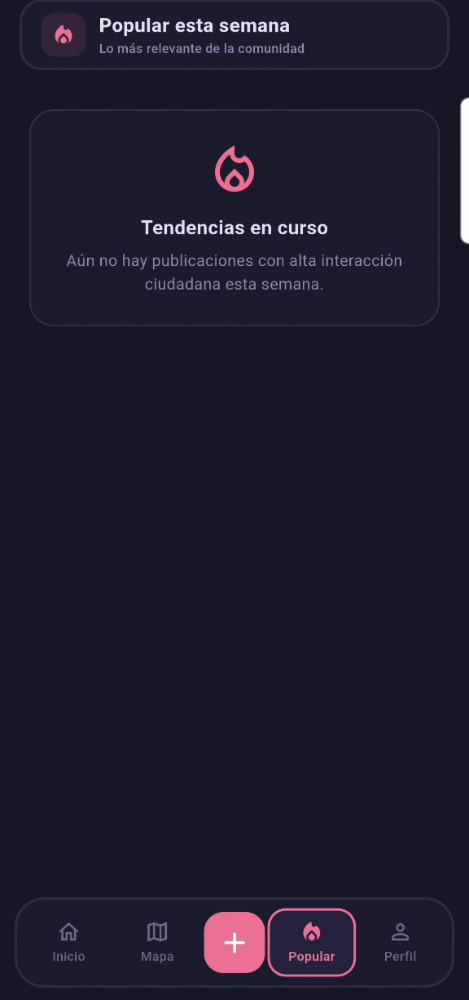
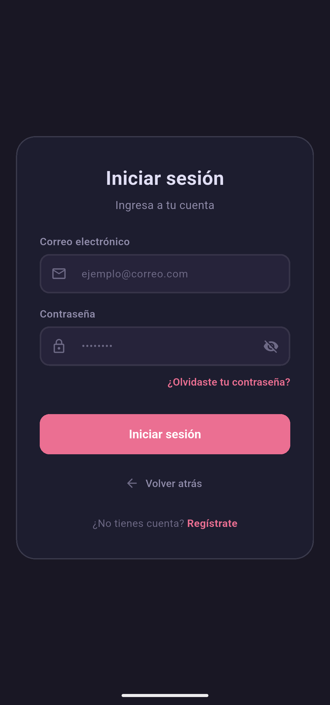

<div align="center">
  

# RDReporta

**Tu comunidad al día.**

Plataforma ciudadana para publicar, consultar y localizar incidencias comunitarias en la República Dominicana.

<p>
  
  
  
  
  
  
  
</p>
</div>

RDReporta reúne una aplicación móvil en Flutter, una API en ASP.NET Core y un panel web de administración. Los ciudadanos pueden compartir lo que ocurre en su comunidad, adjuntar evidencias, ubicar reportes y reaccionar a las publicaciones. El equipo de moderación puede revisar denuncias y gestionar el contenido desde el panel web.

## Funciones de la aplicación móvil

### Inicio y consulta de incidencias

- **Para ti:** muestra publicaciones destacadas y, cuando no hay resultados, utiliza las publicaciones recientes.
- **Cerca de mí:** consulta incidencias cercanas a la ubicación del dispositivo, con permiso de localización.
- **Recientes:** permite consultar las publicaciones más nuevas.
- **Filtros por categoría:** accidentes, tránsito, calles y vías, y las demás categorías activas configuradas en el sistema.
- **Actualización y paginación:** permite refrescar el contenido y cargar más publicaciones.
- **Tarjetas informativas:** muestran autor, verificación del perfil, categoría, fecha, evidencias, ubicación, reacciones y visualizaciones.

### Detalle, evidencias y reacciones

- Consulta del título, descripción, autor, fecha y categoría de cada incidencia.
- Galería de imágenes y reproducción de video dentro de las publicaciones.
- Ubicación con provincia, municipio, referencia y coordenadas cuando están disponibles.
- Selector de reacciones con emojis y actualización de los contadores.
- Registro de visualizaciones por usuario y actualización de contadores en tiempo real.
- Acceso al perfil público del autor y opción para denunciar contenido.

<table>
  <tr>
    <th>Inicio</th>
    <th>Reacciones</th>
    <th>Detalle de la incidencia</th>
  </tr>
  <tr>
    <td></td>
    <td></td>
    <td></td>
  </tr>
</table>

### Radar de incidencias y mapas

- Mapa centrado en la República Dominicana con marcadores de incidencias geolocalizadas.
- Filtros por categoría y consulta de las incidencias geolocalizadas del país.
- Alternancia entre la vista de mapa y la lista de incidencias.
- Tarjeta del marcador con evidencias, título, ubicación y acceso al detalle.
- Selector de ubicación para colocar un reporte moviendo el mapa y confirmando el punto elegido.

<table>
  <tr>
    <th>Radar de incidencias</th>
    <th>Detalle del marcador</th>
    <th>Selección de ubicación</th>
  </tr>
  <tr>
    <td></td>
    <td></td>
    <td></td>
  </tr>
</table>

### Publicación de reportes

- Selección de categoría, título y descripción de la incidencia.
- Hasta **cuatro fotografías y un video** por reporte, desde cámara o galería.
- Videos de hasta **tres minutos y 150 MB**; imágenes de hasta **10 MB** por archivo.
- Provincia, municipio, barrio o sector y calle o punto de referencia.
- Ubicación mediante **GPS**, selección en el **mapa** o introducción de **latitud y longitud**.
- Autocompletado de la dirección a partir de las coordenadas disponibles y opción para corregir los datos antes de publicar.
- Publicación con o sin coordenadas. Las incidencias sin coordenadas no se representan como puntos en el mapa.
- Conservación del formulario y de los archivos ya subidos durante un reintento, si una carga falla.

<table>
  <tr>
    <th>Datos y evidencias</th>
    <th>Ubicación por GPS</th>
    <th>Revisión de la ubicación</th>
  </tr>
  <tr>
    <td></td>
    <td></td>
    <td></td>
  </tr>
</table>

### Tendencias de la comunidad

La sección **Popular esta semana** reúne las publicaciones activas de los últimos siete días, ordenadas según sus reacciones y visualizaciones. Incluye actualización manual, paginación y un mensaje informativo cuando todavía no hay resultados. La captura muestra ese estado vacío real.

<p align="center">
  
</p>

### Acceso y gestión de la cuenta

- Registro con nombre de usuario, correo electrónico, contraseña y provincia.
- Inicio de sesión por correo y contraseña.
- Integración con Google y con Apple en las plataformas compatibles, una vez configurados sus servicios.
- Recuperación de contraseña mediante código enviado por correo y cambio de contraseña desde el flujo de recuperación.
- Consulta de contenido público sin iniciar sesión; las acciones de publicación e interacción requieren una cuenta.
- Restauración de sesión, renovación de tokens y cierre de sesión.

<p align="center">
  
</p>

### Perfiles, publicaciones propias y preferencias

| Función | Qué permite hacer |
| --- | --- |
| Perfil personal | Consultar nombre, usuario, provincia, fecha de registro, insignia de verificación y número de reportes y seguidores. |
| Edición del perfil | Cambiar el nombre visible, el nombre de usuario y la provincia, con las validaciones de la aplicación. |
| Foto de perfil | Seleccionar una imagen de la galería, recortarla y actualizar el avatar. |
| Perfiles públicos | Consultar la información y publicaciones de otros ciudadanos. |
| Seguimiento | Seguir o dejar de seguir perfiles y consultar sus contadores de seguidores y seguidos. |
| Mis reportes | Consultar las publicaciones propias y eliminar un reporte con confirmación. |
| Apariencia | Elegir tema oscuro Rosé Pine, claro Dawn o automático según el sistema. |
| Privacidad | Consultar la información de privacidad y convivencia de la comunidad. |
| Eliminación de cuenta | Solicitar el borrado desde el perfil, con doble confirmación y escritura de la palabra ELIMINAR. |

### Notificaciones y convivencia

- Bandeja de notificaciones con fecha, estado de lectura y carga de mensajes anteriores.
- Contador de notificaciones sin leer y apertura de la incidencia relacionada.
- Integración con Firebase Cloud Messaging para recibir avisos push cuando el servicio está configurado y el usuario concede permiso.
- Denuncia de publicaciones por información falsa, spam, acoso, datos personales, contenido violento, ubicación incorrecta, duplicados u otros motivos.
- Revisión de las denuncias desde el panel de moderación.

Las funciones de perfiles, preferencias, notificaciones y moderación están implementadas en el código; no se incluyen capturas de esas pantallas en este README.

## Panel web de administración

El panel React ofrece acceso según los roles **Moderador** y **Administrador**.

| Módulo | Funciones |
| --- | --- |
| Dashboard | Totales de publicaciones, incidencias activas y resueltas, visualizaciones, reacciones y denuncias pendientes. |
| Publicaciones | Búsqueda, filtros por estado y categoría, paginación, consulta del detalle y cambio de estado. |
| Moderación | Consulta de denuncias y de la publicación asociada; descarte o resolución ocultando contenido, con notas de revisión. |
| Usuarios | Búsqueda de usuarios y activación o retirada de la insignia de verificación. Disponible para administradores. |
| Categorías | Consulta, creación y edición de categorías: nombre, descripción, icono, color y orden. La escritura requiere rol de administrador. |
| Apariencia | Selección del tema visual del panel. |

Los estados de las publicaciones son **activa**, **resuelta**, **oculta** y **archivada**. Las capturas de esta página corresponden a la aplicación móvil; no se incluyen imágenes de muestra del panel web.

## Tecnologías y organización

| Componente | Tecnologías |
| --- | --- |
| Aplicación móvil | Flutter, Dart, Dio, almacenamiento seguro, Google Maps, geolocalización, cámara, galería y reproducción de video. |
| API | ASP.NET Core / .NET 10, Entity Framework Core, autenticación JWT, BCrypt, OpenAPI y Scalar. |
| Datos geográficos | PostgreSQL 16, PostGIS, Npgsql y NetTopologySuite. |
| Panel administrativo | React 19, TypeScript, Vite y Lucide. |
| Servicios e infraestructura | Docker Compose, Firebase Cloud Messaging, SMTP y almacenamiento local o compatible con S3. |
| Procesamiento de imágenes | Magick.NET para decodificación, orientación y eliminación de metadatos. |

```text
RdReporta/
├── mobile/                  Aplicación Flutter y recursos visuales
├── admin/                   Panel web React
├── backend/
│   ├── src/
│   │   ├── RdReporta.Api/             Endpoints, configuración y servicios HTTP
│   │   ├── RdReporta.Application/     Casos de uso, DTO e interfaces
│   │   ├── RdReporta.Domain/          Entidades y enumeraciones
│   │   └── RdReporta.Infrastructure/  Persistencia, seguridad y almacenamiento
│   └── tests/              Comprobaciones existentes del backend
├── database/               Inicialización de PostGIS y catálogos SQL
├── docker/                 Docker Compose y plantilla de entorno
├── docs/media/             Capturas utilizadas en este README
└── scripts/                Herramientas de comprobación del proyecto
```

## Seguridad y datos privados

Las contraseñas, claves JWT, cuentas de servicio, certificados, configuraciones Firebase y archivos `.env` deben permanecer fuera del control de versiones.

El backend aplica permisos por rol, validaciones de archivos, comprobaciones de propiedad de los medios subidos y límites de solicitudes. Las imágenes se vuelven a codificar, se orientan y se eliminan sus metadatos antes de almacenarse. En producción, sirve la API mediante HTTPS y restringe las claves de mapas a las aplicaciones autorizadas.

Si una credencial se publicó anteriormente, revócala y rótala: retirarla de la versión actual no la invalida ni la elimina del historial de Git.
